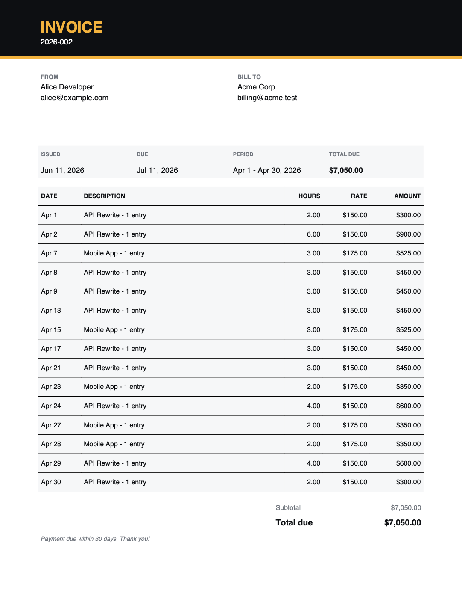
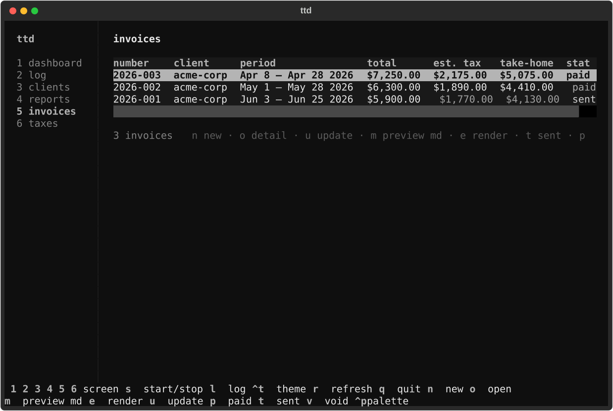

# Invoicing

From unbilled hours and reimbursable expenses to a client-ready PDF — with the
billing math explicit and the history immutable.

## How an invoice is built

`invoice create` gathers the client's **uninvoiced, billable** entries and
**expenses** in the period. Time entries group into line items — one per
project per day (e.g. "API Rewrite — 3 entries"). Each line's duration is
rounded per your [billing config](#billing-rounding), priced at the
[resolved rate](clients-and-projects.md#how-hourly-rates-resolve), and the
rate is frozen onto the invoice so later rate changes never rewrite history.

[Expenses](expenses.md) add as separate reimbursable lines — untaxed,
pass-through amounts frozen at invoice time. An invoice with only expenses (no
time) is valid.

The invoice's **stored period** is derived from the actual line dates (min–max
of time `work_date` and expense `incurred_date`), not necessarily the window
you requested. Requesting `last month` but only billing June 16–30 records
June 16–30 on the invoice.

## Creating an invoice

```console
$ ttd invoice create --client acme-corp              # last calendar month
$ ttd invoice create --client acme-corp --month 2026-05
$ ttd invoice create --client acme-corp --from 2026-05-15 --to 2026-05-31
$ ttd invoice create --client acme-corp --period "last month"
$ ttd invoice create --client acme-corp --period "2026-05-01 to 2026-05-31"
$ ttd invoice create --client acme-corp --period "last two weeks"
$ ttd invoice create --client acme-corp --period "june 16 to june 30"
$ ttd invoice create --client acme-corp --number 2026-CUSTOM-1
```

`--period` accepts the same strings as the TUI invoice wizard:

- `last month` (default), `this month`, `this week`, `last week`
- `last <N> days|weeks|months` (e.g. `last 14 days`, `last two weeks`)
- `YYYY-MM`, `YYYY-MM-DD to YYYY-MM-DD`
- Month-name ranges: `june`, `june 2025`, `june 16 to june 30`, `june 16–30`

`-i` opens a form with a live total preview instead.

### Preview with --dry-run

```console
$ ttd invoice create --client acme-corp --dry-run
```

Prints time lines, expense lines (when present), subtotal, tax, expenses
subtotal, and total — and changes nothing. When `tax.set_aside_rate` is set,
the preview also shows how much to set aside and the estimated take-home
(subtotal minus set-aside).

## Reimbursable expenses

Expense lines appear in a separate section on PDF and Markdown renders. They
are **not taxed** — tax applies only to the time subtotal:

```text
total = time_subtotal + tax + expenses_subtotal
```

Log expenses with [`ttd expense`](expenses.md) or the TUI (`l` → expense).
Attach receipts via the CLI; embed them in the PDF with `--receipts` on
create or render (see below).

## Rendering PDF and Markdown

Render at creation time with `--pdf` and/or `--md`, or any time later:

```console
$ ttd invoice create --client acme-corp --pdf --md
$ ttd invoice render 2026-001                 # re-render both
$ ttd invoice render 2026-001 --pdf --out ~/Desktop
$ ttd invoice render 2026-001 --pdf --receipts  # append expense receipt pages
```

`--receipts` merges receipt files into the PDF after the invoice page. When
`invoice.attach_receipts` is `true` in [config](configuration.md#invoice-receipts),
receipts are included by default. Markdown cannot embed receipts — ttd refuses
`--md` when receipts would be included.

Files are named `{number}-{client-slug}.pdf` / `.md` and written to
`invoice.output_dir` (`~/Documents/invoices` by default). The PDF is a clean
single-page letterhead layout; the Markdown comes from a template, handy for
pasting into email or converting with pandoc.



## The invoice lifecycle

| Status | Meaning |
| --- | --- |
| `draft` | Created; entries and expenses are locked to it |
| `sent` | Issued to the client |
| `paid` | Payment received — **tax set-aside is frozen at this moment** |
| `void` | Cancelled — **its entries and expenses are released** for re-invoicing |

```console
$ ttd invoice mark 2026-001 sent
$ ttd invoice mark 2026-001 paid --paid-date 2026-06-09
$ ttd invoice mark 2026-001 void
```

`--paid-date` defaults to today; correcting it re-freezes the set-aside into
the right tax quarter. Voided invoices keep their number forever — numbers
are never reused.

## Reviewing invoices

```console
$ ttd invoice list            # newest first: number, client, period, total, status
$ ttd invoice show 2026-001   # time line items, dates, subtotal/tax/total, set-aside
$ ttd invoice show 2026-001 --format md   # rendered Markdown to stdout (preview)
```

`invoice show --format md` prints the same Markdown the TUI preview (`m`) shows,
without writing a file — use `invoice render --md` when you want files on disk.

The default table format lists **time lines only**; expense lines appear in
`--format md`, TUI detail (`o`), and rendered PDFs
([#17](https://github.com/syn54x/ttd/issues/17)).

When `tax.set_aside_rate` is greater than zero, `invoice list` also shows
**Est. Tax** and **Take-Home** columns. Unpaid invoices preview at the current
rate (shown muted); paid invoices use the frozen snapshot from when they were
marked paid. With the rate at `0` (the default), those columns are omitted.

`invoice show` includes the same set-aside and take-home figures — a preview
for open invoices, frozen amounts for paid ones.

## Invoice numbering

Numbers come from the `invoice.number_format` template — default
`{year}-{seq:03d}` → `2026-001`, `2026-002`, … The sequence increments within
whatever fields you use:

```console
$ ttd config set invoice.number_format "{year}{month:02d}-{seq:02d}"   # 202606-01
```

Available fields: `{year}`, `{month}`, `{seq}`.

## Customizing your invoices

All in [config](../reference/configuration.md):

- `user.name` / `user.email` / `user.address` — the FROM block
- `invoice.payment_terms_days` — due date, 30 days by default
- `invoice.tax_rate` — tax added to the subtotal, as a fraction (`0.08` = 8%)
- `invoice.output_dir` — where rendered files go
- `invoice.attach_receipts` — default `--receipts` on render
- `business.currency` (and per-client currency) — amounts and symbols

## Billing rounding

Rounding applies to each line item's rolled-up daily duration:

- `billing.increment_minutes` — the granularity, 15 minutes by default
- `billing.rounding` — `nearest` (default), `up`, or `none`

A project-day totalling **1h07m** bills as **1h00m** with `nearest`, **1h15m**
with `up`, and exactly **1h07m** with `none`. What you log is never changed —
only what's billed.

## Refreshing an invoice

Recompute an existing invoice from its **locked entries and expenses** using
current billing rules, rates, tax config, and description logic (including
entry notes). Preview shows a before/after diff; nothing changes until you
confirm.

```console
$ ttd invoice refresh 2026-001              # print diff
$ ttd invoice refresh 2026-001 --apply      # apply when allowed
```

The CLI shows expense subtotal changes when they differ. The TUI refresh modal
does not yet ([#21](https://github.com/syn54x/ttd/issues/21)).

| Status | Preview | Apply |
| --- | --- | --- |
| `void` | Blocked | — |
| `draft`, `sent` | Full recalc diff | Updates lines and invoice totals |
| `paid` | Full recalc diff | **Descriptions only** — apply is blocked when totals or line amounts would change |

Paid invoices never update `set_aside`, `paid_date`, or header totals. To change
billing on a paid invoice, void it and re-invoice.

Refresh does **not** pull in new uninvoiced entries or edit locked entry data.

## Invoices in the TUI

Screen `5` lists invoices with status pills. When a tax set-aside rate is
configured, the table also shows **est. tax** and **take-home** columns (dim
for unpaid previews, normal for paid). The detail modal (`o`) shows time and
expense line tables plus est. tax / take-home when configured.



| Key | Action |
| --- | --- |
| `n` | new invoice (pick client, live-preview period and expense lines) |
| `o` | open detail (time + expense tables) |
| `u` | refresh — recompute from locked entries (before/after diff) |
| `m` | preview the Markdown render |
| `e` | render format modal — receipts / PDF / Markdown checkboxes |
| `t` / `p` / `v` | mark sent / paid / void |

The render modal (`e`) lets you choose whether to embed expense receipts in
the PDF. Receipts and Markdown are mutually exclusive, matching the CLI.
