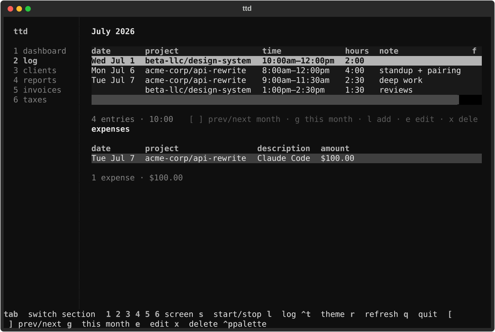

# Managing entries

Listing, correcting, and deleting logged time. For creating entries, see
[Tracking time](tracking-time.md). For expenses, see [Expenses](expenses.md).

## Listing entries

```console
$ ttd entry list --week                  # this week
$ ttd entry list --month                 # this month
$ ttd entry list --from 2026-06-01 --to 2026-06-07
$ ttd entry list -p api-rewrite          # filter by project
$ ttd entry list --client acme-corp      # or by client
```

Each row shows the entry's short id, time range (or plain duration), hours,
note, and flags — `nb` for non-billable, `inv` for invoiced.

## JSON output for scripting

```console
$ ttd entry list --week --json | jq '[.[] | .hours] | add'
```

Stable, machine-readable output of the same rows — pipe it anywhere.

## Editing an entry

Take the id (a unique prefix is enough) from `entry list`:

```console
$ ttd entry edit a3f2 --time "9-11:30"        # re-time it
$ ttd entry edit a3f2 -n "auth endpoints" --tags backend
$ ttd entry edit a3f2 -p design --client beta-llc   # move it to another project
$ ttd entry edit a3f2 --billable false
```

`--time` accepts the same [time expressions](../reference/time-expressions.md)
as `ttd log`.

## Deleting entries

```console
$ ttd entry rm a3f2
```

## Invoiced entries are locked

Once an entry is on an invoice, `entry edit` and `entry rm` refuse to touch
it — the ledger always matches what you billed. To change billed work, void
the invoice first ([`ttd invoice mark NUMBER void`](invoicing.md#the-invoice-lifecycle)),
which releases its entries, then edit and re-invoice.

## The log screen

Screen `2` in the TUI shows the current month's time entries and expenses in
two stacked tables:



| Key | Action |
| --- | --- |
| `[` / `]` | previous / next month |
| `g` | jump to this month |
| `tab` | switch focus: time table ↔ expenses table |
| `e` | edit the selected row (section-aware) |
| `x` | delete the selected row (confirms first) |
| `l` | add time or expense (global chooser) |

Expense rows use the same edit/delete keys when the expenses section is
focused. Invoiced expenses cannot be changed until the invoice is voided.
